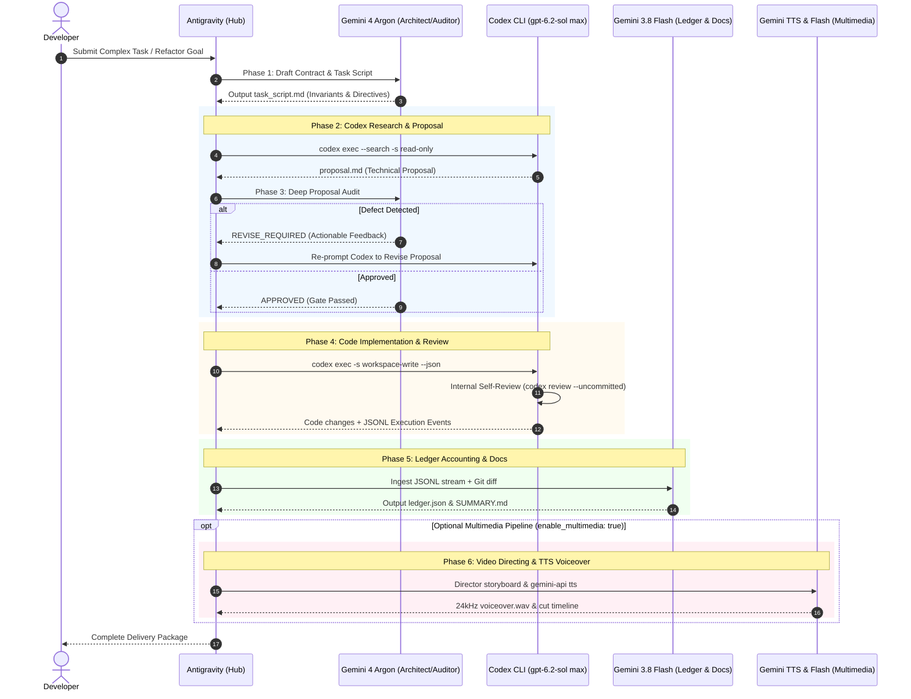

# ⚡ Antigravity Codex Orchestrator

> **The Autonomous Hybrid Multi-Agent Playbook uniting Google Antigravity, OpenAI Codex CLI (`gpt-6.2-sol max`), Gemini 4 Argon, Gemini 3.8 Flash & Gemini TTS.**

<p align="center">
  <strong>English</strong> | <a href="README.zh-CN.md">简体中文</a>
</p>

[](LICENSE)
[](https://deepmind.google/technologies/gemini/)
[](https://github.com/openai/codex)
[-black.svg)](https://openai.com)
[](https://ai.google.dev)
[](CONTRIBUTING.md)

---

## 🌟 Overview

**Antigravity Codex Orchestrator** is an open-source, modular, zero-intrusion engineering playbook designed for next-generation multi-agent software engineering.

Instead of locking developers into brittle, black-box scripts, this playbook leverages the native strengths of Google and OpenAI frontier models in an auditable, Swarm-like assembly line:

| Agent / Harness | Model Engine | Specialization | Role in Pipeline |
|---|---|---|---|
| **Orchestration Hub** | **Google Antigravity (AGY)** | Agent Lifecycle & Workspace Memory | Task Coordinator & State Machine |
| **Execution Worker** | **OpenAI Codex CLI** | `gpt-6.2-sol` (reasoning: `max`) | Research (`--search`), Code Generation, Self-Review |
| **Chief Architect & Auditor** | **Gemini 4 Argon** | `gemini-4-argon` / Antigravity Pro | Task Scripting (`task_script.md`), Strict Proposal Audit Gate |
| **Ledger Master & Scribe** | **Gemini 3.8 Flash** | `gemini-3.8-flash` / Antigravity Flash | JSONL Event Parsing, Structured Ledger (`ledger.json`), Docs |
| **Multimedia Director & TTS** | **Gemini 3.8 Flash + TTS** | `gemini-3.8-flash-tts` (24kHz WAV) | Visual Storyboarding, Multi-Speaker Voiceover (`Kore`/`Puck`) |

---

## 🏗️ Architecture & Flow



---

## 🛡️ Anti-Drift: Pre-Flight Harness Verification Gate

To prevent calling the wrong harness or writing outside the workspace, Antigravity displays a **Pre-Flight Inspection Card** before invoking any external execution engine:

```text
┌─────────────────────────── [Harness Pre-Flight Verification] ───────────────────────────┐
│ Phase:        Phase 4 (Code Implementation & Self-Review)                               │
│ Target Tool:  OpenAI Codex CLI (v0.156.0+)                                              │
│ Bound Model:  gpt-6.2-sol (Reasoning Effort: max)                                        │
│ Isolation:    workspace-write (Scoped strictly to target directory)                      │
│ Stdin Mode:   Closed (stdin=DEVNULL, eliminating Windows terminal deadlocks)            │
│ Command:      "" | codex exec -m gpt-6.2-sol -c model_reasoning_effort="max" ...         │
│ Dependencies: task_script.md, proposal.md (Argon Audit: APPROVED)                        │
└─────────────────────────────────────────────────────────────────────────────────────────┘
```

> 💡 **Step-by-Step Mode**: Set `step_by_step_gate: true` to pause at every gate and wait for your explicit confirmation (`Proceed [Y/n]`).

---

## 📊 Live Visual Dashboard (Generative UI)

The playbook includes a standalone interactive HTML5 dashboard ([dashboard/harness_dashboard.html](dashboard/harness_dashboard.html)) with built-in **EN / 中文 live language switching**, providing Swarm-like live state monitoring:

- Node Status Badges: `PENDING`, `RUNNING`, `APPROVED`, `REVISE_REQUIRED`.
- Exact CLI parameters, sandbox policies, and verified paths.
- Token consumption metrics (`input_tokens`, `output_tokens`, `cached_tokens`) and elapsed execution duration.

---

## 🚀 Quick Start

### 1. Installation in Antigravity

Clone or copy this repository into your project's `.agents/skills` or Antigravity's global plugin directory:

```bash
# As a Project-level Skill
git clone https://github.com/TardisBooo/antigravity-codex-orchestrator.git .agents/skills/playbook-codex-gemini

# Or as a Global Antigravity Plugin
git clone https://github.com/TardisBooo/antigravity-codex-orchestrator.git ~/.gemini/config/plugins/antigravity-codex-orchestrator
```

### 2. Verify Prerequisites

Ensure your environment has:
- **Node.js** (>= 20) & **OpenAI Codex CLI** (`npm i -g @openai/codex`)
- **Google Antigravity** or **Gemini CLI** (`gemini-api`)
- Active authentication for both Codex (`codex login`) and Gemini (`export GEMINI_API_KEY="..."` or `gemini-api configure`)

### 3. Trigger in Chat

Simply instruct Antigravity in your conversation:

```markdown
# Standard execution (Defaults to gpt-6.2-sol max)
"Run the codex-gemini playbook to implement a distributed retry client and output the full ledger."

# High-Safety step-by-step mode
"Run the codex playbook with step_by_step_gate enabled."

# Architecture only (No code execution)
"Use the codex playbook to evaluate the architecture up to Phase 3 (Proposal Audit) only."

# With multimedia presentation
"Run the codex playbook and enable the multimedia pipeline to generate a narrated voiceover."
```

---

## ⚙️ Configuration Matrix (`playbook_config`)

Customize any parameter directly in [playbooks/codex_gemini_collaboration_playbook.md](playbooks/codex_gemini_collaboration_playbook.md):

```yaml
playbook_config:
  # Models
  codex_model: "gpt-6.2-sol"       # Default Codex model
  codex_reasoning_effort: "max"    # max | high | medium | low
  
  # Safety & UI
  enable_visual_dashboard: true   # Renders Swarm-like visual dashboard
  step_by_step_gate: false        # Require human confirmation at each phase

  # Workflow Slices
  enable_codex_search: true       # Search web/docs with Codex
  enable_argon_audit: true        # Gemini 4 Argon deep reasoning audit
  enable_codex_review: true       # Automatic `codex review --uncommitted`
  enable_flash_ledger: true       # Compiles ledger.json and SUMMARY.md
  enable_multimedia: false        # Direct video timeline & Gemini TTS audio
  
  # Multimedia Voice
  tts_primary_voice: "Kore"       # Kore | Puck | Fenrir | Aoede
  tts_multi_speaker: "Alice=Kore,Bob=Puck"
```

---

## 📂 Repository Structure

```text
antigravity-codex-orchestrator/
├── .agents/skills/playbook-codex-gemini/
│   └── SKILL.md                 # Native Antigravity Skill Definition
├── playbooks/
│   └── codex_gemini_collaboration_playbook.md  # Standalone Markdown Playbook
├── schemas/
│   └── ledger_schema.json       # JSON Schema for Task Ledger
├── templates/
│   └── script_template.md       # Argon Medium Task Script Template
├── scripts/
│   └── orchestrator.py          # Reference Python Runner (Non-blocking CLI)
├── dashboard/
│   └── harness_dashboard.html   # Generative UI Live Dashboard (EN/中文)
├── LICENSE                      # Apache 2.0
├── CONTRIBUTING.md
├── README.md                    # English Documentation
└── README.zh-CN.md              # 简体中文文档
```

---

## 🤝 Contributing & Community

Contributions are welcome! Please check out [CONTRIBUTING.md](CONTRIBUTING.md) to submit improvements to prompt templates, ledger schemas, or new harness integrations.

- GitHub Issues: Bug reports, model integration feedback, and feature requests.
- License: [Apache License 2.0](LICENSE).
