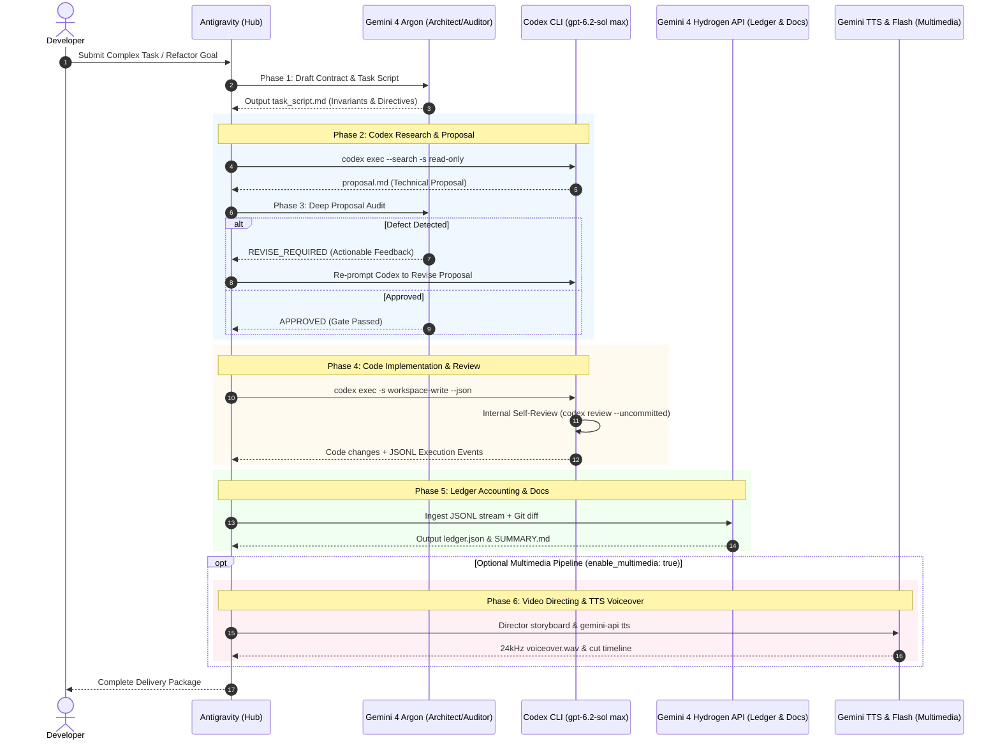

# ⚡ Antigravity Codex Orchestrator

> **The Autonomous Hybrid Multi-Agent Playbook uniting Google Antigravity, OpenAI Codex CLI (`gpt-6.2-sol max`), Gemini 4 Argon, Gemini 4 Hydrogen & Gemini TTS.**

<p align="center">
  <strong>English</strong> | <a href="README.zh-CN.md">简体中文</a>
</p>

[Install the direct plugin](#install-the-direct-plugin) to run a task through Codex CLI from Antigravity and review its changes and tests in plain language.

[](LICENSE)
[](https://deepmind.google/technologies/gemini/)
[](https://github.com/openai/codex)
[-black.svg)](https://openai.com)
[](https://ai.google.dev)
[](CONTRIBUTING.md)

> **Interactive benchmark article:** Explore the [GitHub Pages benchmark report](https://tardisbooo.github.io/antigravity-codex-orchestrator/) for the side-by-side Playbook and Codex CLI evaluation, raw traces, and artifacts.

---

## 🌟 Overview

**Antigravity Codex Orchestrator** is an open-source, modular, zero-intrusion engineering playbook designed for next-generation multi-agent software engineering.

Instead of locking developers into brittle, black-box scripts, this playbook leverages the native strengths of Google and OpenAI frontier models in an auditable, Swarm-like assembly line:

| Agent / Harness | Model Engine | Specialization | Role in Pipeline |
|---|---|---|---|
| **Orchestration Hub** | **Google Antigravity (AGY)** | Lightweight Dispatcher & State Machine | Pure Orchestration, Pre-flight Verification, Translation (No heavy generation) |
| **Execution Engine** | **OpenAI Codex CLI** | `gpt-6.2-sol` (reasoning: `max` / selectable) | Research (`--search`), Code Generation, Self-Review (`codex review`) |
| **Architect & Auditor Gate** | **Gemini 4 Hydrogen (API)** | `gemini-4-hydrogen` | Phase 1 Task Scripting (`task_script.md`) & Phase 3 Proposal Audit Gate |
| **Ledger Master & Scribe** | **Gemini 4 Hydrogen (API)** | `gemini-4-hydrogen` | Phase 5 Event Parsing, Structured Ledger (`ledger.json`) & Docs |
| **Multimedia Director & TTS** | **Hydrogen (API) + Gemini TTS** | `gemini-4-hydrogen` + `gemini-3.8-flash-tts` | Phase 6 Visual Storyboarding (`timeline.json`) & 24kHz Audio Synthesis |

---


---

## ⚡ Two Playbook Flavors / 两种运行版本

This repository offers two distinct, modular playbooks:

### 1. `playbook-codex-gemini` (Full Dispatched Multi-Agent Pipeline)
- **Zero Local Overhead**: Antigravity acts purely as an orchestrator/dispatcher.
- **Externalized Intelligence**:
  - **Codex CLI (`gpt-6.2-sol max`)**: Research, coding, self-review.
  - **Gemini 4 Hydrogen API**: Task scripting, proposal audit gate, ledger/docs, storyboard director.
  - **Gemini TTS**: High-fidelity speech synthesis.
- **Best For**: Mission-critical software engineering, zero-defect refactoring, and multimedia delivery.

### 2. `playbook-codex-direct` (Codex Direct Relay & Human Translation)
- **Direct Dispatch**: Immediately forwards user tasks to Codex CLI without multi-stage gates.
- **Model Freedom**: User picks any model in chat (`gpt-6.2-sol max`, `gpt-6.2-astra low`, `gpt-5.6-sol`, etc.); defaults to `gpt-6.2-sol max`.
- **Human Translation**: Antigravity translates raw diffs and technical execution logs into clear, jargon-free plain human language ("人话").
- **Best For**: Fast feature iteration, lightweight data processing, bug patching, and effortless handover reports.

## 🏗️ Architecture & Flow



---

## 🛡️ Anti-Drift: Pre-Flight Harness Verification Gate

To prevent calling the wrong harness or writing outside the workspace, Antigravity displays a **Pre-Flight Inspection Card** before invoking any external execution engine:

```text
┌─────────────────────────── [Harness Pre-Flight Verification] ───────────────────────────┐
│ Phase:        Phase 4 (Code Implementation & Self-Review)                               │
│ Target Tool:  OpenAI Codex CLI (v0.156.0+)                                              │
│ Bound Model:  gpt-6.2-sol (Reasoning Effort: max)                                        │
│ Isolation:    workspace-write (Scoped strictly to target directory)                      │
│ Stdin Mode:   Closed (stdin=DEVNULL, eliminating Windows terminal deadlocks)            │
│ Command:      "" | codex exec -m gpt-6.2-sol -c model_reasoning_effort="max" ...         │
│ Dependencies: task_script.md, proposal.md (Argon Audit: APPROVED)                        │
└─────────────────────────────────────────────────────────────────────────────────────────┘
```

> 💡 **Step-by-Step Mode**: Set `step_by_step_gate: true` to pause at every gate and wait for your explicit confirmation (`Proceed [Y/n]`).

---

## 📊 Live Visual Dashboard (Generative UI)

The playbook includes a standalone interactive HTML5 dashboard ([dashboard/harness_dashboard.html](dashboard/harness_dashboard.html)) with built-in **EN / 中文 live language switching**, providing Swarm-like live state monitoring:

- Node Status Badges: `PENDING`, `RUNNING`, `APPROVED`, `REVISE_REQUIRED`.
- Exact CLI parameters, sandbox policies, and verified paths.
- Token consumption metrics (`input_tokens`, `output_tokens`, `cached_tokens`) and elapsed execution duration.

---

## 🚀 Quick Start

### Install the direct plugin

Install [Antigravity CLI](https://antigravity.google/docs/cli/install) and [Codex CLI](https://github.com/openai/codex). Sign in to Codex with `codex login`.

```bash
agy plugin install https://github.com/TardisBooo/antigravity-codex-orchestrator
agy plugin list
```

Open a session in the target workspace and run `/playbook-codex-direct`. For example, ask it to review the project's tests in read-only mode. For code changes, confirm the target workspace and permission to write. Codex sends the task and the project context it reads to its configured model provider.

To remove the plugin, run `agy plugin uninstall antigravity-codex-orchestrator`.

### Run the optional Gemini playbook

The Gemini playbook runs from a source checkout. It also needs Python 3, the `gemini-api` CLI, and `GEMINI_API_KEY` in your environment. The Hydrogen helper also accepts `PLAYBOOK_KEY_FILE` for a file you choose. Keep credentials outside the repository. Review which task materials, diffs, or logs each external call will receive before approving it. Follow the [full playbook](playbooks/codex_gemini_collaboration_playbook.md) for phase controls and usage.

```markdown
# Standard execution (Defaults to gpt-6.2-sol max)
"Run the codex-gemini playbook to implement a distributed retry client and output the full ledger."

# High-Safety step-by-step mode
"Run the codex playbook with step_by_step_gate enabled."

# Architecture only (No code execution)
"Use the codex playbook to evaluate the architecture up to Phase 3 (Proposal Audit) only."

# With multimedia presentation
"Run the codex playbook and enable the multimedia pipeline to generate a narrated voiceover."
```

---

## ⚙️ Configuration Matrix (`playbook_config`)

Customize any parameter directly in [playbooks/codex_gemini_collaboration_playbook.md](playbooks/codex_gemini_collaboration_playbook.md):

```yaml
playbook_config:
  # Models
  codex_model: "gpt-6.2-sol"       # Default Codex model
  codex_reasoning_effort: "max"    # max | high | medium | low
  
  # Safety & UI
  enable_visual_dashboard: true   # Renders Swarm-like visual dashboard
  step_by_step_gate: false        # Require human confirmation at each phase

  # Workflow Slices
  enable_codex_search: true       # Search web/docs with Codex
  enable_argon_audit: true        # Gemini 4 Argon deep reasoning audit
  enable_codex_review: true       # Automatic `codex review --uncommitted`
  enable_flash_ledger: true       # Compiles ledger.json and SUMMARY.md (Hydrogen API)
  hydrogen_model: "gemini-4-hydrogen"
  enable_multimedia: false        # Direct video timeline & Gemini TTS audio
  
  # Multimedia Voice
  tts_primary_voice: "Kore"       # Kore | Puck | Fenrir | Aoede
  tts_multi_speaker: "Alice=Kore,Bob=Puck"
```

---

## 📂 Repository Structure

```text
antigravity-codex-orchestrator/
├── plugin.json                 # Antigravity plugin manifest for the direct relay
├── assets/logo.png
├── .agents/skills/playbook-codex-direct/
│   └── SKILL.md                 # Direct relay skill
├── .agents/skills/playbook-codex-gemini/
│   └── SKILL.md                 # Optional Gemini workflow skill
├── playbooks/
│   └── codex_gemini_collaboration_playbook.md  # Standalone Markdown Playbook
├── schemas/
│   └── ledger_schema.json       # JSON Schema for Task Ledger
├── templates/
│   └── script_template.md       # Argon Medium Task Script Template
├── scripts/
│   └── orchestrator.py          # Reference Python Runner (Non-blocking CLI)
├── dashboard/
│   └── harness_dashboard.html   # Generative UI Live Dashboard (EN/中文)
├── LICENSE                      # Apache 2.0
├── CONTRIBUTING.md
├── README.md                    # English Documentation
└── README.zh-CN.md              # 简体中文文档
```

---

## 🤝 Contributing & Community

Contributions are welcome! Please check out [CONTRIBUTING.md](CONTRIBUTING.md) to submit improvements to prompt templates, ledger schemas, or new harness integrations.

- GitHub Issues: Bug reports, model integration feedback, and feature requests.
- License: [Apache License 2.0](LICENSE).
