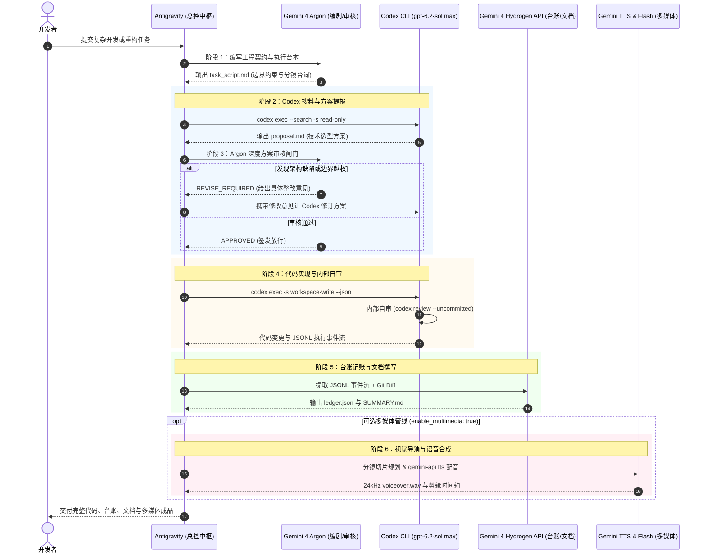

# ⚡ Antigravity Codex Orchestrator

> **联合 Google Antigravity、OpenAI Codex CLI (`gpt-6.2-sol max`)、Gemini 4 Argon、Gemini 4 Hydrogen 与 Gemini TTS 的高可用多智能体协同 Playbook。**

<p align="center">
  <a href="README.md">English</a> | <strong>简体中文</strong>
</p>

[](LICENSE)
[](https://deepmind.google/technologies/gemini/)
[](https://github.com/openai/codex)
[-black.svg)](https://openai.com)
[](https://ai.google.dev)
[](CONTRIBUTING.md)

---

## 🌟 项目概览

**Antigravity Codex Orchestrator** 是一个**开源、模块化、零侵入**的下一代多智能体软件工程协作剧本（Playbook）。

它不将开发者锁死在脆弱的黑盒脚本中，而是依托 Antigravity 原生调度能力，让 Google 与 OpenAI 的前沿模型在一条**全流程透明、可审计、类似 Swarm 看板可视化**的流水线上各司其职：

| 智能体 / Harness | 底层模型引擎 | 能力专长 | 流水线中的核心职责 |
|---|---|---|---|
| **总控调度 (Hub)** | **Google Antigravity (AGY)** | 轻量调度网关与状态机 | 纯粹编排调度、起飞前核验与人话转译（本地不承担繁重生成） |
| **执行引擎 (Worker)** | **OpenAI Codex CLI** | `gpt-6.2-sol` (推理: `max`，会话可自选) | 资料检索 (`--search`)、代码编写重构、自我代码评审 (`codex review`) |
| **架构台本与方案审核** | **Gemini 4 Hydrogen (API)** | `gemini-4-hydrogen` (经 `key.txt` 直连) | 阶段一任务台本编制 (`task_script.md`) 与阶段三方案深度审核闸门 |
| **台账管家与文书** | **Gemini 4 Hydrogen (API)** | `gemini-4-hydrogen` (经 `key.txt` 直连) | 阶段五解析 JSONL、生成结构化台账 (`ledger.json`) 与技术总结 |
| **视觉导演与语音合成** | **Hydrogen (API) + Gemini TTS** | `gemini-4-hydrogen` + `gemini-3.8-flash-tts` | 阶段六分镜切片规划 (`timeline.json`) 与 24kHz 拟真双角色配音合成 |

---


---

## ⚡ 两种版本剧本 (Two Playbook Flavors)

本项目提供两种即插即用、完全声明式的协作剧本：

### 1. `playbook-codex-gemini` (全外包协同流水线)
- **本地零重型消耗**：Antigravity 仅负责流程状态机、起飞前核验卡与分发。
- **全能力外部化**：
  - **Codex CLI (`gpt-6.2-sol max`)**：搜料、编码、内部自审。
  - **Gemini 4 Hydrogen API (经 `key.txt` 调度)**：阶段一台本编制、阶段三方案审核、阶段五台账与文档、阶段六分镜导演。
  - **Gemini TTS**：24kHz 语音合成。
- **适用场景**：复杂生产级工程重构、严格安全审核与多媒体汇报交付。

### 2. `playbook-codex-direct` (直通转发与人话转译工作流)
- **任务直发**：跳过繁杂多阶段闸门，Antigravity 组装提示词后直接驱动 Codex CLI 执行。
- **模型自由**：会话中随时切换模型（如 `6.2 sol max`、`6.2 astra low`、`5.6 sol` 等），默认 `gpt-6.2-sol` (effort: `max`)。
- **人话转译**：Codex 完成后，Antigravity 负责将晦涩的 Git Diff 与技术日志翻译为通俗直白的大白话（讲清改了哪、为什么改、如何验证），并输出 `SUMMARY.md`。
- **适用场景**：日常敏捷开发、快速修 Bug、轻量脚本编写与低负担工作交接。

## 🏗️ 协同架构与时序流



---

## 🛡️ 防错核心：起飞前 Harness 校验卡

为了彻底消除“哪一步执行错了”或“调用错了 Harness/路径”的担忧，Antigravity 在调起任何外部执行引擎前，会强制打印**起飞前校验卡 (Pre-Flight Inspection Card)**：

```text
┌─────────────────────────── [Harness Pre-Flight Verification] ───────────────────────────┐
│ 阶段编号: 阶段四 (代码实现与内部自审)                                                      │
│ 目标工具: OpenAI Codex CLI (v0.156.0+)                                                  │
│ 模型绑定: gpt-6.2-sol (Reasoning Effort: max)                                            │
│ 沙箱隔离: workspace-write (严格限定写入范围至目标工作区)                                    │
│ 输入控制: Closed (stdin=DEVNULL，彻底解决 Windows 终端死锁挂起)                            │
│ 完整指令: "" | codex exec -m gpt-6.2-sol -c model_reasoning_effort="max" ...             │
│ 前置依赖: task_script.md, proposal.md (Argon Audit 状态: APPROVED)                       │
└─────────────────────────────────────────────────────────────────────────────────────────┘
```

> 💡 **单步人工确认模式**：只需在指令中开启 `step_by_step_gate: true`，Antigravity 会在每个阶段调用前暂停，展示校验卡并等待你的明确放行指令（`Proceed [Y/n]`）。

---

## 📊 实时可视化态势大屏 (Generative UI)

本 Playbook 内置了一套交互式 HTML5 态势感知看板（[dashboard/harness_dashboard.html](dashboard/harness_dashboard.html)），支持 **中英文实时一键切换**，提供类似 Swarm 的全局状态监控：

- 节点流转状态标牌：`PENDING`（等待）、`RUNNING`（执行中）、`APPROVED`（通过）、`REVISE_REQUIRED`（打回）。
- 底层参数穿透检查：点击任意节点即可核对实际执行的 CLI 命令、沙箱策略与工作目录。
- 资源统计：实时追踪 `input_tokens`、`output_tokens`、`cached_tokens` 与耗时。

---

## 🚀 快速上手

### 1. 安装到 Antigravity

将本仓库克隆到当前项目的 `.agents/skills` 目录，或 Antigravity 的全局插件目录：

```bash
# 方式 A：作为项目级 Skill 引入
git clone https://github.com/TardisBooo/antigravity-codex-orchestrator.git .agents/skills/playbook-codex-gemini

# 方式 B：作为 Antigravity 全局插件安装
git clone https://github.com/TardisBooo/antigravity-codex-orchestrator.git ~/.gemini/config/plugins/antigravity-codex-orchestrator
```

### 2. 环境前提校验

确保本地已配置好：
- **Node.js** (>= 20) 与 **OpenAI Codex CLI** (`npm i -g @openai/codex`)
- **Google Antigravity** 或 **Gemini CLI** (`gemini-api`)
- 已完成 Codex (`codex login`) 与 Gemini (`export GEMINI_API_KEY="..."` 或 `gemini-api configure`) 的认证

### 3. 在对话中自主调用

你只需在 Antigravity 对话中按需下达指令，即可灵活裁切任意阶段：

```markdown
# 标准全量执行（默认使用 gpt-6.2-sol max）
“按 codex 协同 playbook 帮我实现分布式限流器，并输出完整台账。”

# 高安全单步确认模式
“按 codex playbook 执行此重构，开启单步确认闸门 (step_by_step_gate)。”

# 仅输出方案与审核（不写代码）
“使用 codex playbook 评估架构拆分方案，只执行到阶段三（方案审核），不需要写代码。”

# 开启多媒体演示生成
“按 codex playbook 执行此任务，并开启多媒体管线生成一段架构解说配音。”
```

---

## ⚙️ 配置参数字典 (`playbook_config`)

你可以随时直接编辑 [playbooks/codex_gemini_collaboration_playbook.md](playbooks/codex_gemini_collaboration_playbook.md) 中的任意参数：

```yaml
playbook_config:
  # 模型绑定
  codex_model: "gpt-6.2-sol"       # 默认 Codex 模型
  codex_reasoning_effort: "max"    # max | high | medium | low
  
  # 可视化与防错安全闸门
  enable_visual_dashboard: true   # 渲染类似 Swarm 的态势大屏
  step_by_step_gate: false        # 每阶段前等待人类确认放行

  # 模块化阶段开关
  enable_codex_search: true       # 使用 Codex 联网/搜集材料
  enable_argon_audit: true        # Gemini 4 Argon 深度方案审核
  enable_codex_review: true       # 自动运行 `codex review --uncommitted`
  enable_flash_ledger: true       # 编译 ledger.json 与 SUMMARY.md (Hydrogen API)
  hydrogen_model: "gemini-4-hydrogen"
  hydrogen_key_file: "E:\\Workspaces\\key.txt"   # 或环境变量 PLAYBOOK_KEY_FILE，切勿提交 key
  enable_multimedia: false        # 视频分镜导演与 Gemini TTS 音频合成
  
  # 语音音色
  tts_primary_voice: "Kore"       # Kore | Puck | Fenrir | Aoede
  tts_multi_speaker: "Alice=Kore,Bob=Puck"
```

---

## 📂 仓库目录结构

```text
antigravity-codex-orchestrator/
├── .agents/skills/playbook-codex-gemini/
│   └── SKILL.md                 # Antigravity 原生 Skill 规范文件
├── playbooks/
│   └── codex_gemini_collaboration_playbook.md  # 独立 Markdown 执行剧本
├── schemas/
│   └── ledger_schema.json       # 任务台账 JSON Schema 契约
├── templates/
│   └── script_template.md       # Argon Medium 任务台本模版
├── scripts/
│   └── orchestrator.py          # 非交互式防挂起参考运行器 (Python CLI)
├── dashboard/
│   └── harness_dashboard.html   # Generative UI 态势大屏 (支持中英文切换)
├── LICENSE                      # Apache 2.0 开源协议
├── CONTRIBUTING.md              # 贡献指南
├── README.md                    # English Documentation
└── README.zh-CN.md              # 简体中文文档
```

---

## 🤝 参与贡献

欢迎任何形式的贡献！请查阅 [CONTRIBUTING.md](CONTRIBUTING.md) 提交 Prompt 模版优化、台账字段扩展或新的 Harness 适配。

- GitHub Issues：提交 Bug 反馈、模型适配建议或新特性需求。
- 开源协议：[Apache License 2.0](LICENSE)。
